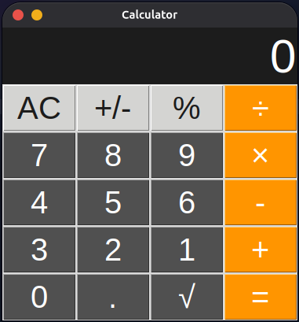
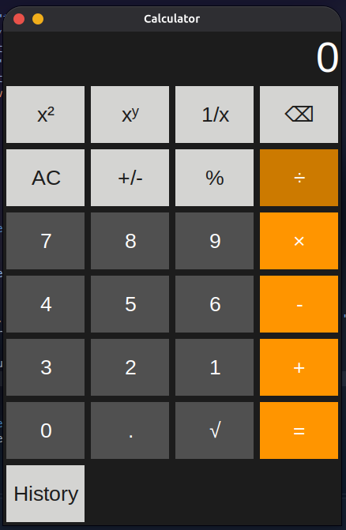
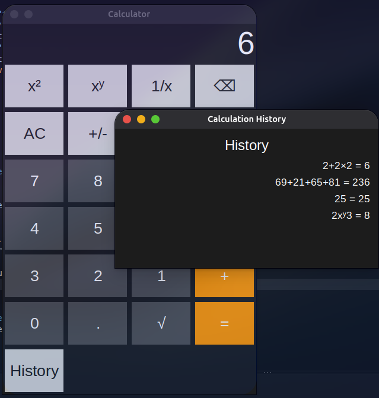

# Calculator-Python

An attempt to recreate the Calculator app found on Apple, Android, and Windows, with a focus on replicating its design, functionality, and user experience.

## Screenshot

This was the first interface of the calculator.

This is the final version

and this is the history tab
